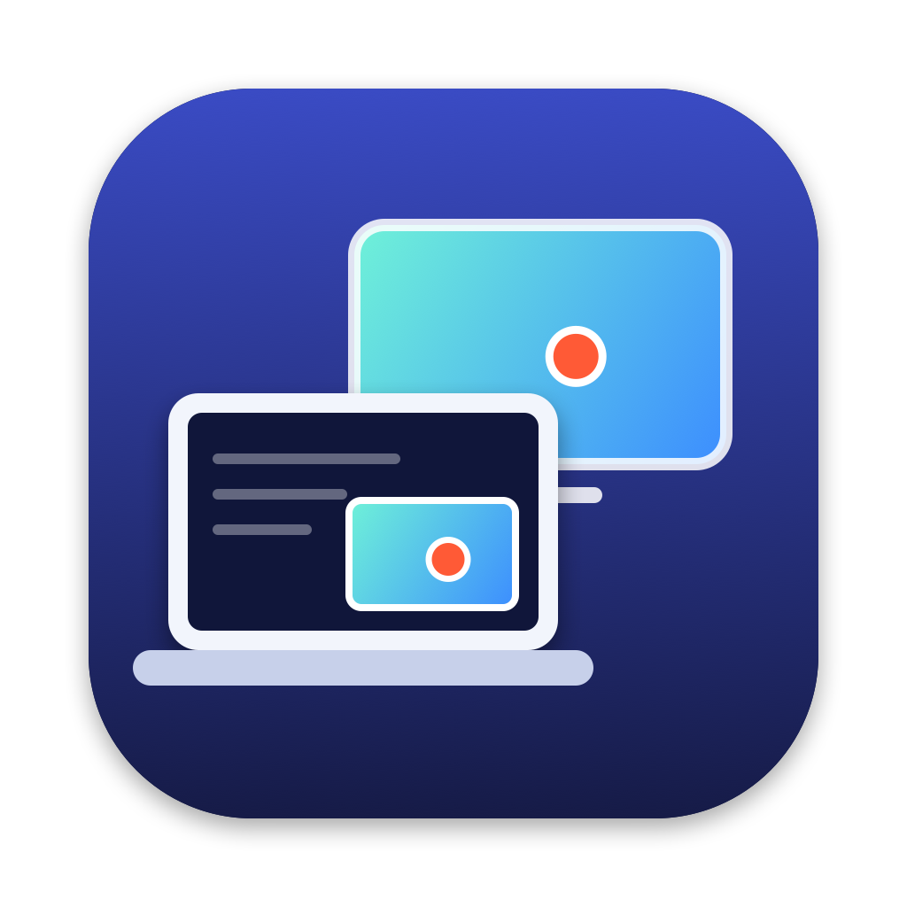

<p align="center">
  
</p>

<h1 align="center">ScreenPeek</h1>

<p align="center">
  See and control your second screen without looking at it.<br>
  A free, open-source tool for macOS and Windows.
</p>

---

You present on a projector or TV that faces the audience, and you can't see it from where you sit. ScreenPeek puts a small live preview of that screen on your laptop. You click in the preview to click on the real screen, and hotkeys move windows between screens without dragging.

## Features

- **Live preview** of the second screen in a small floating window that stays on top and doesn't take focus.
- **Click through.** Clicking in the preview clicks the same spot on the second screen, then the mouse jumps straight back. Double-click, right-click and scroll work too.
- **Send windows with a hotkey.** One hotkey moves the window you're using to the second screen and fills it. Another brings it back.
- **Cursor lock** keeps your mouse from drifting onto the audience screen.
- **Change flash.** A red border tells you the second screen just changed.
- **Lightweight.** The preview is downscaled and captured at about 15 fps.

## Hotkeys

| Action | macOS | Windows |
|---|---|---|
| Show / hide preview | `⌃⌥⌘P` | `Ctrl+Alt+Shift+P` |
| Send front window to the second screen | `⌃⌥⌘→` | `Ctrl+Alt+Shift+→` |
| Bring front window back | `⌃⌥⌘←` | `Ctrl+Alt+Shift+←` |
| Keep cursor off the second screen | `⌃⌥⌘L` | `Ctrl+Alt+Shift+L` |

The menu bar icon (macOS) or tray icon (Windows) lets you pick which screen to preview. To try ScreenPeek with a single screen, pick your main screen.

## Install

Download the latest build from [Releases](../../releases).

### macOS (14 or later, Apple silicon and Intel)

1. Open `ScreenPeek.dmg` and drag `ScreenPeek` into Applications.
2. The app is not notarized, so the first time macOS blocks it. Open it once, then go to **System Settings → Privacy & Security → Open Anyway**. Alternatively, run `xattr -dr com.apple.quarantine /Applications/ScreenPeek.app`.
3. Allow **Screen Recording** (for the preview) and **Accessibility** (for clicks and moving windows), then reopen the app.

### Windows (10 or later, x64 and ARM64)

1. Download `ScreenPeek-win-x64.exe` (or `-arm64`). It is a single file and needs nothing installed.
2. The exe is not code-signed, so SmartScreen warns you. Click **More info → Run anyway**.

Windows needs no extra permissions. The only limit is that ScreenPeek can't click into programs running as administrator unless ScreenPeek itself runs as administrator.

## Build from source

macOS (needs Xcode or the Command Line Tools):

```sh
mac/build.sh            # → mac/build/ScreenPeek.app
```

Windows (needs the .NET 10 SDK; this also builds from macOS or Linux):

```sh
windows/build.sh        # → windows/build/ScreenPeek-win-x64.exe, -win-arm64.exe
```

Icons are generated from `assets/icon/make-icon.swift` with `assets/icon/build-icons.sh`, which needs ImageMagick for the `.ico`.

On macOS, the local build is signed ad-hoc, so macOS asks for permissions again after each rebuild.

## How it works

| | macOS | Windows |
|---|---|---|
| Capture | ScreenCaptureKit | GDI `StretchBlt`, scaled straight to preview size |
| Click through | `CGEvent` + `CGWarpMouseCursorPosition` | `SendInput` + `SetCursorPos` |
| No focus stealing | non-activating `NSPanel` | `WS_EX_NOACTIVATE` |
| Move windows | Accessibility API | `SetWindowPos` |
| Cursor lock | mouse monitor that pushes the cursor back | `ClipCursor` |
| Hotkeys | Carbon `RegisterEventHotKey` | `RegisterHotKey` |

## License

[MIT](LICENSE)
